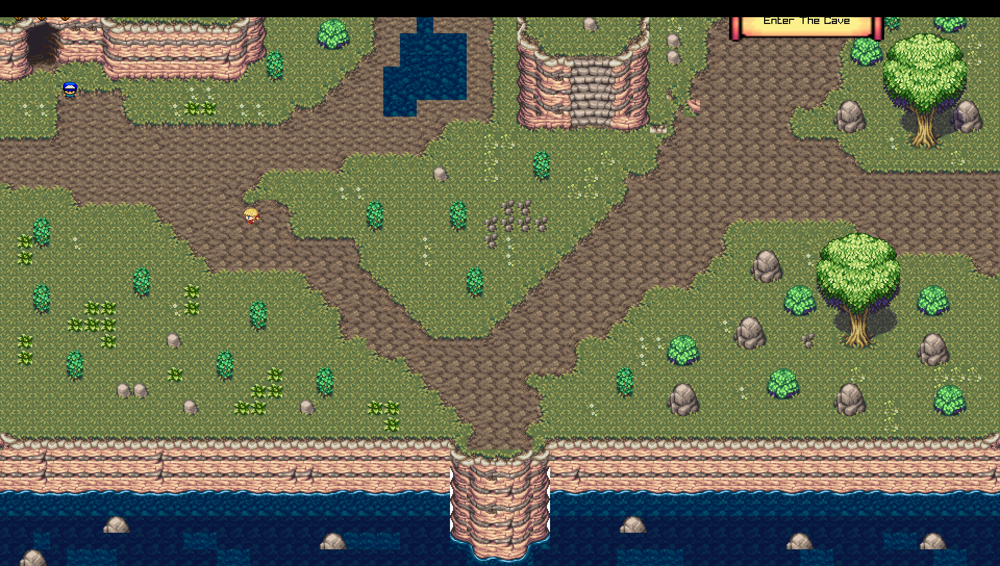

# Arin's Adventure

2D adventure game written in C++ with raylib and maps built in Tiled.



Originally built in 2024 as a Game Mechanics project and later separated into this standalone repository.

## Game

- village, cave and multi-floor dungeon areas
- objective-driven progression
- NPCs and scripted events
- collectibles, keys and temporary power-ups
- turret and projectile hazards
- map transitions, cutscenes and screen shake

## Download

Windows builds are published through [GitHub Releases](../../releases) when a release is available.

## Build

```powershell
cmake -S . -B build -A x64
cmake --build build --config Release --parallel
```

The executable is written to `build/Release/ArinsAdventure.exe`.

The public repository contains the game code but not the licensed runtime art/audio/map assets. See [`docs/BUILDING.md`](docs/BUILDING.md) for local setup and [`ASSETS.md`](ASSETS.md) for asset provenance.

## Stack

`C++17` · `raylib 5.0` · `raygui` · `Tiled` · `Tileson`

